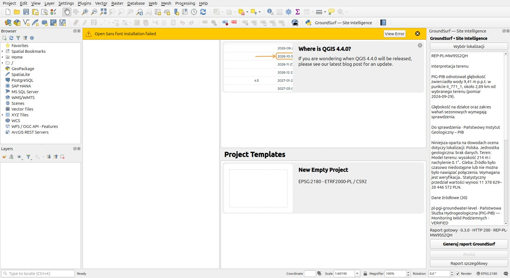

# Release verification · 9 November 2026

**Package** GroundSurf-QGIS-0.3.0.zip, 76,828 bytes  
**SHA-256** `f6402dc43e1fce68f92049001f9c7e52c3aba1990def81448903e44dcb0ca8a0`  
**Host** Ubuntu 24.04.5 LTS, QGIS 3.34.4 Prizren, visible Ubuntu desktop, separate QGIS profile. The package metadata and diagnostic both identify 0.3.0.

## Baseline

The original plugin checkout was main at `121105a`. Its two uncommitted edits were copied into a separate worktree. The default profile's plugin.py SHA-256 matched 0.2.0 at `07acb314edece53dcc3529eb2909b43edc65b29f516edf9d37c06029bfa8fbe6`. The baseline ZIP was dist/GroundSurf-QGIS-0.2.0.zip. The 26 original core tests passed. No pre-existing QGIS window was found at the first desktop inspection. No applicable AGENTS.md was found under either checkout or its ancestors.

The 0.2.1 edits added a persistent site outline, native selection fallback, elapsed timer, cancel and visible failure status. During this work main advanced independently to `6482972`, which committed those edits. The candidate is based on that commit. It retains their user-facing improvements and uses the production web stream through the shared QGIS network manager. The global QGIS network timeout stays at its existing setting. The existing Ubuntu checkouts and default QGIS installation were not upgraded by the candidate tests.

## Visible acceptance

The baseline used a freshly extracted 0.2.0 ZIP in a separate profile. A QTest-driven address search and actual map-canvas mouse clicks in a visible QGIS window reproduced both failures. In an empty EPSG:2180 project the first Kraków result was correct, but the drawn vertices near the canvas centre were outside Poland. The non-streaming report request ended after 60.7 seconds with an operation-cancelled error, no HTTP status and the report text still saying it was requesting evidence. A web-stream request with the same original shape returned a country-mismatch evidence item. This isolated the map and network defects.

The final package was installed using QGIS's Install from ZIP implementation into the empty `accepted` profile. The loaded file was `/tmp/groundsurf-qgis-6m67V9/profiles/profiles/accepted/python/plugins/groundsurf_qgis/plugin.py`. Live Photon returned five matches for the public landmark Rynek Główny, Kraków. The test selected the first match, drew four corners, double-clicked the last corner and validated the WGS84 position before submission. The final Generate click produced the Polish interpretation, status, identifier and evidence in the visible dock.

| Check | Observed |
|---|---|
| Final release ZIP, Kraków | HTTP 200, 99.2 seconds, **REP-PL-MW9SS2QH**, 30 evidence records, 633 visible pixels of report area |
| Groundwater | PIG-PIB monitoring point II_771_1, 9.41 m below ground, 29 September 2026, about 2.89 km away. The Polish text identifies off-site measurement and seasonal uncertainty |
| Validation, cancel, retry | Missing-country feedback before network submission. Cancel retained the drawn site. Retry used the same geometry |
| Evidence | Native reader showed 30 items. Searching II_771_1 returned one. Its PIG-PIB ID and reference matched the source feature before the station was plotted |
| Boundary identity | Service returned a different official parcel. Local reopen restored all four originally submitted vertices exactly. Official and selected geometries remained separately accessible |
| Stored report comparison | Every field returned by deployed GET /api/reports/:id matched the native record. QGIS added only selected_boundary (web convention) and qgis_site_kind (origin). Firefox rendered a 28,762-character Polish detailed report with the same station and PIG-PIB source |
| Berlin | On the 0.3.0 candidate before the final boundary-origin addition, EPSG:4326 selected layer → explicit Polish → EPSG:3857 project change → unchanged request. HTTP 200, 69.1 seconds, **REP-DE-MW9SJMKR**, 18 records. A live follow-up received a Polish groundwater answer. The unrelated test feature attribute was absent from the request |
| Parcel and overlays | Live ULDK lookup returned parcel 126105_9.0001.311 at the public Kraków test point. Native topography, cadastral and SMGP raster providers all initialized successfully |
| Export | Native PDF opened as a PDF file, full JSON round-tripped, local manifest matched the separately executed web exporter across all 30 records at a fixed timestamp. Clipboard link and iframe used fixture share confirmation |
| Fixtures | 32 pure-Python tests and three PyQGIS smoke programs passed. Extra stored-report test passed. Covered split UTF-8, CRLF, heartbeat, truncated/error/malformed responses, size cap, duplicate clicks, slow response, site switch, missing groundwater, unavailable AI/cadastre, HTTP 503, timeout, retry, 24-item search, and unload |

## Remaining release work

- Desktop validation covered one Ubuntu/QGIS combination. Windows, macOS, QGIS 3.28 and Qt 6 have not been exercised.
- English and Polish cover the primary controls. Remaining translations, provider-specific English claims, country-specific presentations and other partial parity are listed in PARITY.md.
- Confirm maintainer email, public source and issue tracker availability, GPL-compatible licence for the plugin and bundled web-export code, and third-party notices before catalogue submission. The public feedback address was not adopted as package contact. The QGIS publication guidance is at https://plugins.qgis.org/docs/publish.
- Durable sharing failure/confirmation was exercised with a fixture. National parcel adapters beyond those tested, third-party overlay rendering at all scales, and Helsinki/Stockholm imagery alignment still need coverage.
- Original web analyses and QGIS-selected boundaries can differ from the official parcel returned by country providers. A server-only historical record may lack the original selected outline. The native reader labels the geometry available in the stored report.
